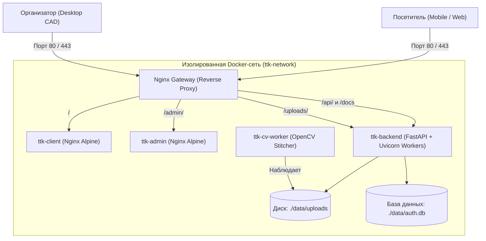

# Руководство по развёртыванию (Production Deployment Guide)

Проект **ТТК «Интерактивная indoor-навигация и 360°-панорамы»** подготовлен к промышленному развёртыванию на любом Linux-сервере (VPS/VDS: Selectel, Timeweb, Reg.ru, Hetzner, AWS, VK Cloud) или локальном стенде.

---

## 1. Архитектура продакшен-окружения



### Сравнение режимов работы

| Параметр | Режим разработки (`start.sh` / `start.ps1`) | Продакшен-режим (`deploy.sh` / `deploy.ps1`) |
|---|---|---|
| **Фронтенды** | Vite Dev Server (Node.js 20, ~1.2 ГБ RAM) | **Nginx Alpine + скомпилированный SPA (<30 МБ RAM)** |
| **Сборка** | Hot Module Replacement (динамическая) | **Multi-stage build: минифицированный JS/CSS** |
| **Точка входа** | Разрозненные порты (3000, 3001, 8000) | **Единый Nginx Gateway на порту 80/443** |
| **Бэкенд** | 1 процесс Uvicorn | **Пул Uvicorn воркеров + Non-root безопасность** |
| **Статика** | Раздача через Node/Python | **Gzip, кэширование ассетов на 1 год (`max-age=31536000, immutable`)** |
| **Перезапуск** | `unless-stopped` | **`always` (автостарт при перезагрузке сервера)** |

---

## 2. Быстрый запуск в один клик

### На Linux-сервере (Ubuntu 20.04 / 22.04 / 24.04, Debian)
```bash
# 1. Клонируйте репозиторий
git clone https://github.com/<your-org>/ttk-indoor-map.git
cd ttk-indoor-map

# 2. Запустите автоматический деплой
chmod +x deploy.sh
./deploy.sh
```

### На Windows-сервере / локально (PowerShell)
```powershell
.\deploy.ps1
```

*Скрипт автоматически:*
1. Создаст конфигурационный файл `.env` с уникальным 256-битным ключом `TTK_JWT_SECRET`.
2. Подготовит необходимые директории хранения данных.
3. Соберёт многоэтапные оптимизированные образы (`Dockerfile.prod`).
4. Запустит стек и дождётся успешного прохождения проверок работоспособности (Healthchecks).

---

## 3. Таблица маршрутизации Nginx Gateway

При заходе на ваш сервер (например, `http://your-server-ip/` или `http://map.ttk.ru/`):

| URL | Сервис назначения | Описание |
|---|---|---|
| `/` | `ttk-client:80` | Мобильный интерфейс посетителя (A*, 2D-карта, 360°-тур, гироскоп) |
| `/admin/` | `ttk-admin:80` | Студия организатора (CAD-редактор, масштабирование, стены, POI) |
| `/api/` | `ttk-backend:8000` | REST API (авторизация, расчёт маршрутов, загрузка ассетов) |
| `/docs` | `ttk-backend:8000` | Интерактивная Swagger/OpenAPI спецификация API |
| `/uploads/` | `ttk-backend:8000` | Раздача обработанных панорам WebP и поэтажных планов |

> **Примечание:** Для удобства отладки прямые порты микросервисов также доступны:
> - Клиент: `http://localhost:3000`
> - Админка: `http://localhost:3001`
> - API: `http://localhost:8000`

---

## 4. Конфигурация окружения (`.env`)

Все параметры настраиваются в файле `.env`:

```ini
# Секретный ключ подписи JWT токенов
TTK_JWT_SECRET=f9a83c7e1b5d4e2098471a2c3d5e7f809b1c2d3e4f5a6b7c8d9e0f1a2b3c4d5e

# Учётные данные администратора по умолчанию
TTK_ADMIN_EMAIL=admin@ttk.example.com
TTK_ADMIN_PASSWORD=Admin12345!
TTK_ADMIN_INVITE_CODE=TTK-ADMIN-2026

# Учётные данные посетителя
TTK_USER_EMAIL=user@ttk.example.com
TTK_USER_PASSWORD=User12345!

# Публичный адрес для генерации ссылок и QR-кодов
PUBLIC_MAP_BASE_URL=https://map.ttk.ru

# Разрешённые CORS-источники (* или список через запятую)
TTK_CORS_ORIGINS=*

# Порты хоста
PORT_HTTP=80
PORT_BACKEND=8000
PORT_CLIENT=3000
PORT_ADMIN=3001
```

---

## 5. Подключение домена и HTTPS (Let's Encrypt / SSL)

Для получения бесплатного доверенного SSL-сертификата выполните на сервере:

```bash
# 1. Установите certbot
sudo apt update && sudo apt install -y certbot

# 2. Выпустите сертификат (временно освободив 80 порт или через webroot)
sudo certbot certonly --standalone -d map.ttk.ru

# 3. Сертификаты сохранятся в:
# /etc/letsencrypt/live/map.ttk.ru/fullchain.pem
# /etc/letsencrypt/live/map.ttk.ru/privkey.pem
```

Раскомментируйте секцию SSL в `nginx/nginx.conf` и пробросьте том с сертификатами в `docker-compose.prod.yml`:
```yaml
volumes:
  - /etc/letsencrypt:/etc/letsencrypt:ro
```

---

## 6. Резервное копирование и сохранность данных

Все пользовательские данные и загруженные карты хранятся на хосте в каталоге `./data/`:

- `./data/auth.db` — база данных SQLite (пользователи, пароли bcrypt, сессии);
- `./data/uploads/` — оригиналы и обработанные панорамы;
- `./data/uploads/venues/` — JSON-схемы опубликованных площадок;
- `./data/uploads/panoramas/` — equirectangular 2:1 WebP-панорамы высокого разрешения.

### Команда быстрого бэкапа:
```bash
tar -czvf ttk-backup-$(date +%F).tar.gz data/ .env
```

---

## 7. Безопасность (Production Hardening)

1. **Non-root пользователи:** Бэкенд исполняется под системным пользователем `ttkapp` (UID 1001), воркер панорам — под `cvworker` (UID 1000). Контейнеры не имеют root-прав на хосте.
2. **Защитные заголовки Nginx:** Включены `X-Content-Type-Options: nosniff`, `X-Frame-Options`, `X-XSS-Protection`.
3. **Хэширование паролей:** Пароли хранятся исключительно в виде bcrypt-хэшей с солью.
4. **Rate Limiting:** Эндпоинты авторизации защищены от перебора паролей (брутфорса).
5. **Ограничение размеров запросов:** Защита от DoS ограничением размера JSON (1 МБ) и загружаемых медиафайлов (35 МБ).
